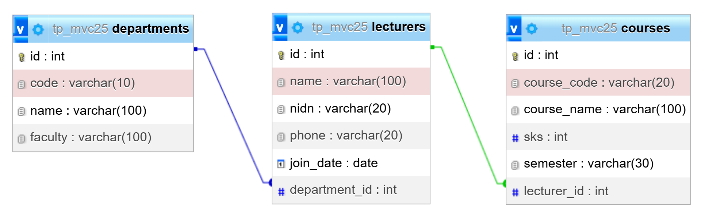

# TP8 DPBO - Implementasi Arsitektur MVC (PHP & MySQL)

Project ini merupakan hasil pengerjaan Tugas Praktikum Modul 9 (Model-View-Controller) mata kuliah Desain dan Pemrograman Berbasis Objek (DPBO). Aplikasi manajemen data kampus (**Campus Data**) ini mengimplementasikan arsitektur **MVC (Model-View-Controller)** dengan PHP & MySQL serta memiliki tiga tabel yang saling berelasi (`departments`, `lecturers`, dan `courses`).

---

## Struktur Direktori

```text
TP8DPBO2526C2/
├── Dokumentasi/
│   ├── Diagram.png          # Diagram ERD relasi database
│   └── Record.mp4           # Screen record hasil running aplikasi
├── Project/                 # Folder utama aplikasi berbasis MVC
│   ├── assets/              # File Bootstrap & JS lokal
│   ├── config/
│   │   └── connection.php   # Konfigurasi koneksi database MySQL
│   ├── controllers/
│   │   ├── Controller.php           # Base Controller (render & redirect)
│   │   ├── CourseController.php     # Controller untuk entitas Course
│   │   ├── DepartmentController.php # Controller untuk entitas Department
│   │   └── LecturerController.php   # Controller untuk entitas Lecturer
│   ├── models/
│   │   ├── Model.php        # Base Model (koneksi MySQLi & prepared statements)
│   │   ├── Course.php       # Model tabel courses
│   │   ├── Department.php   # Model tabel departments
│   │   └── Lecturer.php     # Model tabel lecturers
│   ├── views/
│   │   ├── courses/         # View CRUD Courses (index, create, edit)
│   │   ├── departments/     # View CRUD Departments (index, create, edit)
│   │   ├── lecturers/       # View CRUD Lecturers (index, create, edit)
│   │   └── templates/       # Template header (navbar) & footer
│   └── index.php            # Front controller / router utama
├── tp_mvc25.sql             # File SQL skema database & data awal
└── README.md                # Dokumentasi desain program dan alur aplikasi
```

---

## Desain Program & Relasi Database



Database `tp_mvc25` memiliki 3 tabel yang saling berelasi:

1. **`departments`** *(tabel baru)*
   - `id` (INT, Primary Key, Auto Increment)
   - `code` (VARCHAR(10)) — Kode departemen (contoh: `RPL`, `TEK`, `SIND`)
   - `name` (VARCHAR(100)) — Nama departemen
   - `faculty` (VARCHAR(100)) — Nama fakultas

2. **`lecturers`** *(tabel utama + tambahan atribut `department_id`)*
   - `id` (INT, Primary Key, Auto Increment)
   - `name` (VARCHAR(100)) — Nama dosen
   - `nidn` (VARCHAR(20)) — Nomor Induk Dosen Nasional
   - `phone` (VARCHAR(20)) — Nomor telepon
   - `join_date` (DATE) — Tanggal bergabung
   - `department_id` (INT, Foreign Key → `departments.id`, `ON DELETE SET NULL ON UPDATE CASCADE`)

3. **`courses`** *(tabel baru)*
   - `id` (INT, Primary Key, Auto Increment)
   - `course_code` (VARCHAR(20)) — Kode mata kuliah (contoh: `RP201`)
   - `course_name` (VARCHAR(100)) — Nama mata kuliah
   - `sks` (INT) — Bobot SKS
   - `semester` (VARCHAR(30)) — Semester pelaksanaan
   - `lecturer_id` (INT, Foreign Key → `lecturers.id`, `ON DELETE SET NULL ON UPDATE CASCADE`)

### Ringkasan Relasi
- **One-to-Many (`departments` → `lecturers`)**: Satu departemen dapat memiliki banyak dosen; setiap dosen terhubung ke satu departemen.
- **One-to-Many (`lecturers` → `courses`)**: Satu dosen dapat mengampu banyak mata kuliah; setiap mata kuliah diampu oleh satu dosen.

---

## Penjelasan Alur Program (MVC)

1. **Routing (`Project/index.php`)**:
   - Semua request masuk melalui `index.php` dengan parameter query `controller` (`lecturer`, `department`, `course`) dan `action` (`index`, `create`, `store`, `edit`, `update`, `delete`).
   - Default route mengarah ke `LecturerController::index()`.
2. **Controller (`Project/controllers/`)**:
   - Menerima request dari user, memanggil method pada Model untuk mengambil atau memanipulasi data, lalu meneruskan data ke View melalui `render()` atau melakukan `redirect()`.
3. **Model (`Project/models/`)**:
   - Mengelola koneksi database (`Model.php`) dan seluruh query SQL menggunakan **MySQLi Prepared Statements** (`executeQuery`, `fetchAll`, `fetchOne`, `execute`) serta `LEFT JOIN` untuk menampilkan nama departemen pada daftar dosen dan nama dosen pada daftar mata kuliah.
4. **View (`Project/views/`)**:
   - Menampilkan antarmuka HTML dengan Bootstrap 5 serta sanitasi output menggunakan `htmlspecialchars()` untuk mencegah XSS.

---

## Cara Menjalankan

1. Import file `tp_mvc25.sql` ke MySQL / phpMyAdmin (Laragon / XAMPP).
2. Pastikan konfigurasi database di `Project/config/connection.php` sesuai dengan server lokal Anda (`localhost`, `root`, password kosong, database `tp_mvc25`).
3. Jalankan Apache/Nginx di Laragon lalu akses melalui browser:
   - `http://localhost/TP8DPBO2526C2/Project/`

---

## Dokumentasi

- **ERD Database**: [Diagram.png](Dokumentasi/Diagram.png)
- **Screen Record Aplikasi**: [Record.mp4](Dokumentasi/Record.mp4)
